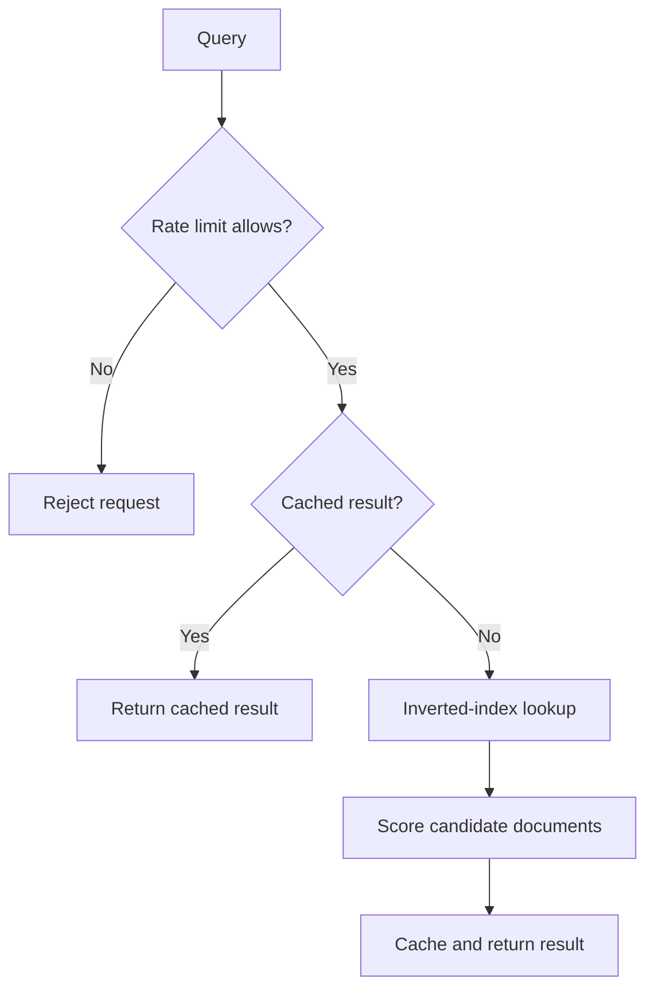

# Document Search Engine (Java)

A Java 17 command-line document search engine maintained by [Yuvraj Singh](https://github.com/YuvrajSinghIIt). It pairs an inverted index with LRU caching and per-user rate limiting to demonstrate the retrieval layer of a RAG-inspired system.

## Features

- Builds an inverted index from a local document collection for targeted keyword lookup.
- Ranks documents by the number of distinct matching query terms, breaking ties by input order.
- Caches repeated queries with an access-ordered LRU cache.
- Demonstrates token-bucket, leaky-bucket, and fixed-window rate limiting.
- Includes deterministic Java tests for search, eviction, timing boundaries, and invalid configuration.
- Uses only the Java standard library—no third-party dependencies.

## Request flow



Rate limiting happens before the cache lookup, so cache hits also consume an allowance. The demo shares a five-entry cache across its rate-limiter stages.

## Requirements

- Java Development Kit (JDK) 17 or newer
- GNU Make (optional, for the commands below)

## Build, run, and test

From the repository root:

```sh
make run
```

Run the test suite:

```sh
make test
```

Without Make:

```sh
mkdir -p build/classes build/test-classes
javac --release 17 -d build/classes $(find src/main/java -name '*.java')
java -cp build/classes com.yuvrajsingh.documentsearch.DocumentSearchApplication
javac --release 17 -cp build/classes -d build/test-classes $(find src/test/java -name '*.java')
java -cp build/classes:build/test-classes com.yuvrajsingh.documentsearch.TestSuite
```

The CLI begins with three short rate-limit demos. Enter a query, type `next` to move between demos, or type `exit` to quit. After the third demo it enters normal token-bucket search mode.

Try `binary search tree` twice to see a cache miss followed by a cache hit.

## Project layout

```text
.
├── src/main/java/com/yuvrajsingh/documentsearch/
│   ├── DocumentSearchApplication.java  # interactive CLI
│   ├── SearchEngine.java                # document loading and ranking
│   ├── LruCache.java                    # access-ordered cache
│   └── RateLimiter.java                 # three limiter strategies
├── src/test/java/.../TestSuite.java     # standard-library test runner
├── documents.txt                        # sample search collection
└── Makefile                             # build, run, test, and cleanup shortcuts
```

## Design notes

Each searchable line in `documents.txt` is one document. Tokenization lowercases alphanumeric terms and ignores punctuation. A result score is the count of distinct query terms found in a candidate document; a query without matching terms returns a clear no-result message.

The project is intentionally an in-memory, single-threaded learning project. Useful next steps include TF-IDF or BM25 ranking, normalized cache keys, concurrent access, and a service API.
